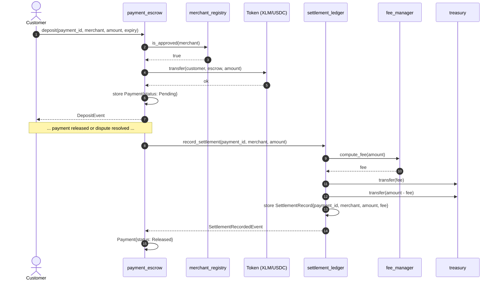

# dabdub_contracts

Soroban smart contracts powering the dabdub payment platform.

## Repository layout

- `dupdub_contracts/` — Soroban smart contracts workspace (Cargo workspace)
- `contracts/` — per-contract crates and documentation
- `scripts/` — deployment and verification helpers
- `.github/workflows/` — CI and deployment pipelines

## Contract Interaction Diagrams

> **Maintenance note:** These diagrams are part of the contract documentation. Whenever a new cross-contract call is added (a new `#[contractclient]` interface, a new `env.invoke_contract` / client invocation, or a new contract-to-contract data dependency), update the relevant diagram below in the same PR. Reviewers should treat a stale diagram as a documentation bug.

### Contract Call Graph

Shows which contracts invoke which other contracts. Arrows point from caller to callee.

```mermaid
flowchart TD
    subgraph Core["Core Payment Flow"]
        PE[payment_escrow]
        SL[settlement_ledger]
        MR[merchant_registry]
        RF[refund_manager]
    end

## Coverage

Per-contract coverage is enforced at **80%** via [`codecov.yml`](codecov.yml); a PR fails if any contract drops below the threshold. Test files and snapshots are excluded from the calculation.

| Contract | Coverage |
|---|---|
| `admin_timelock` | [](https://codecov.io/gh/dupdub/dupdub-contracts?component=admin_timelock) |
| `batch_payments` | [](https://codecov.io/gh/dupdub/dupdub-contracts?component=batch_payments) |
| `fee_calculator` | [](https://codecov.io/gh/dupdub/dupdub-contracts?component=fee_calculator) |
| `fee_distributor` | [](https://codecov.io/gh/dupdub/dupdub-contracts?component=fee_distributor) |
| `liquidity_router` | [](https://codecov.io/gh/dupdub/dupdub-contracts?component=liquidity_router) |
| `merchant_registry` | [](https://codecov.io/gh/dupdub/dupdub-contracts?component=merchant_registry) |
| `multisig_admin` | [](https://codecov.io/gh/dupdub/dupdub-contracts?component=multisig_admin) |
| `payment_escrow` | [](https://codecov.io/gh/dupdub/dupdub-contracts?component=payment_escrow) |
| `payment_request` | [](https://codecov.io/gh/dupdub/dupdub-contracts?component=payment_request) |
| `rbac_access` | [](https://codecov.io/gh/dupdub/dupdub-contracts?component=rbac_access) |
| `reconciliation` | [](https://codecov.io/gh/dupdub/dupdub-contracts?component=reconciliation) |
| `settlement_ledger` | [](https://codecov.io/gh/dupdub/dupdub-contracts?component=settlement_ledger) |
| `slippage_protection` | [](https://codecov.io/gh/dupdub/dupdub-contracts?component=slippage_protection) |
| `stellar_confirmations` | [](https://codecov.io/gh/dupdub/dupdub-contracts?component=stellar_confirmations) |

## Development

    subgraph Support["Supporting Contracts"]
        FE[fee_manager]
        TR[treasury]
        OR[oracle_router]
        DS[dispute_resolver]
        NT[notification_hub]
        AC[access_control]
        UP[upgrade_governor]
        AN[analytics]
        KY[kyc_registry]
        MT[multisig_treasury]
    end

    PE -->|is_approved| MR
    PE -->|record_settlement| SL
    PE -->|transfer| TR
    PE -->|compute_fee| FE
    PE -->|resolve| DS
    PE -->|emit| NT
    PE -->|check_role| AC

    SL -->|compute_fee| FE
    SL -->|transfer| TR
    SL -->|emit| NT
    SL -->|record| AN

    RF -->|transfer| TR
    RF -->|emit| NT
    RF -->|check_role| AC
```

### Payment Escrow Deposit → Settlement Ledger Record (Data Flow)

Shows the data flow when a customer deposits into `payment_escrow` and the escrow later records the settlement in `settlement_ledger`.



## Smart contracts

The Soroban contracts live in the `dupdub_contracts` workspace directory. Build and test them with:

```bash
cd dupdub_contracts
cargo test
```

Or directly with cargo, from `dupdapp_contract/`:

```bash
cd dupdapp_contract
cargo build --target wasm32v1-none --release
cargo test
```

### Running a local Soroban testnet

A Docker-based local Soroban testnet is provided via the [`stellar/quickstart`](https://hub.docker.com/r/stellar/quickstart) container, defined in [`docker-compose.yml`](docker-compose.yml).

**Prerequisites**

- Docker with the Compose plugin (`docker compose`)
- [`stellar-cli`](https://developers.stellar.org/docs/tools/developer-tools) on your `PATH`
- Rust with the `wasm32v1-none` target (see above)

**Start / stop**

```bash
make local-testnet-start   # bring up the quickstart container
make local-testnet-stop    # tear it down
```

Once running, the local network exposes:

- **Soroban RPC**: `http://localhost:8000/soroban/rpc`
- **Horizon**: `http://localhost:8000`
- **Friendbot**: `http://localhost:8000/friendbot`

The quickstart container uses the standard local network passphrase `Standalone Network ; February 2017` and a pre-funded `admin` account.

**Deploy contracts**

With the testnet running, deploy the contracts against it:

```bash
./scripts/deploy-local.sh
```

The script builds the `dabdub_contracts` WASM artifacts and deploys them to the local RPC endpoint using the quickstart default network passphrase and funded account.

### Lint

`make lint` runs all static checks in sequence — `cargo clippy`, `cargo fmt --check`, and `cargo audit` — stopping at the first failure with a message identifying which check failed:

```bash
make lint
```

The pre-push git hook (`.githooks/pre-push`) runs `make lint`, so install the hooks once per clone:

```bash
git config core.hooksPath .githooks
```

## CI/CD

- **CI** ([`.github/workflows/ci.yml`](.github/workflows/ci.yml)) — runs `cargo test`, coverage (tarpaulin), and a WASM build on every push/PR.
- **Deploy** ([`.github/workflows/deploy.yml`](.github/workflows/deploy.yml)) — builds and optimises WASMs, then deploys to Stellar testnet on merges to `main` and to mainnet on version tags (manual approval required).

| Warm cache (registry + `target/` hit) | ~2–4 min |

Actual times vary with runner load and the size of the change; the warm-cache path is typically 3–4× faster because dependencies are not recompiled from scratch.

| Scenario | Approx. duration |
|---|---|
| Cold cache (no cache hit) | ~8–12 min |
| Warm cache (registry + `target/` hit) | ~2–4 min |

Actual times vary with runner load and the size of the change; the warm-cache path is typically 3–4× faster because dependencies are not recompiled from scratch.

## Monitoring

Grafana/Loki/Promtail configs under [`grafana/`](grafana/) and [`docker-compose.yml`](docker-compose.yml) are provided for local observability tooling; see [`monitoring/`](monitoring/) for uptime/status-page setup.

### Alerts

Grafana alert rules are provisioned from [`grafana/provisioning/alerting/`](grafana/provisioning/alerting/). The `ESCROW.emergency_drain` rule fires within 1 minute of any emergency drain event on `payment_escrow`, pages PagerDuty, and notifies Slack `#security`. See the [emergency drain runbook](docs/security/emergency_drain_runbook.md).

## Docs

- [Escrow upgrade procedure](docs/escrow_upgrade_procedure.md)
- [Security docs](docs/security/)

## Links

- **Website**: [https://dupdub.xyz](https://dupdub.xyz)
- **Documentation**: [https://docs.dupdub.xyz](https://docs.dupdub.xyz)

## Handsoff notes

<!-- handsoff-issue-1094 -->
- #1094: merchant_registry and payment_escrow: a merchant suspended after deposit is still paid out by release/release_partial

<!-- handsoff-issue-1107 -->
- #1107: payment_escrow::dispute's _reason parameter is misleadingly underscore-prefixed despite being used, and has no validation

<!-- handsoff-issue-1108 -->
- #1108: payment_escrow: dispute resolution is all-or-nothing on the remainder even after a merchant has already delivered via partial release

<!-- handsoff-issue-1113 -->
- #1113: payment_escrow: the highest-risk functions (upgrade, emergency_drain's XLM path, set_registry(None)) have the thinnest test coverage

<!-- handsoff-issue-1261 -->
- #1261: [P2] payment_escrow: add support for partial dispute resolution

<!-- handsoff-issue-1256 -->
- #1256: [P2] payment_escrow: verify merchant is KYC-verified before allowing deposit

<!-- handsoff-issue-1266 -->
- #1266: [P2] payment_escrow: add `is_expired()` view function

<!-- handsoff-issue-1307 -->
- #1307: [P2] payment_escrow: add is_expired() view function

<!-- handsoff-issue-1313 -->
- #1313: [P3] Add contract README for each of the 14 contracts

<!-- handsoff-issue-1323 -->
- #1323: [P3] Add Grafana alert rule for emergency_drain event
