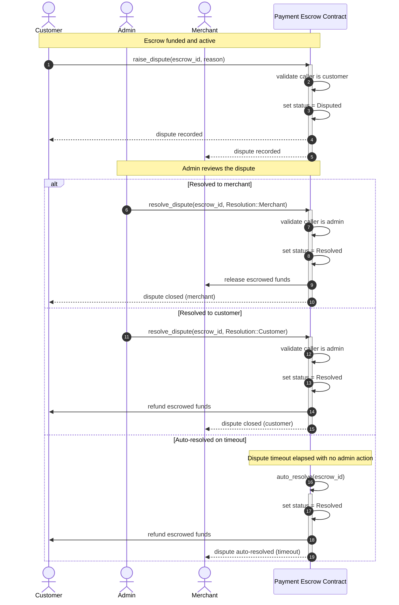

# Payment Escrow Contract

The Payment Escrow contract holds funds for a customer/merchant pair until delivery is confirmed, and provides a dispute resolution flow when the parties disagree.

## Storage Schema Versioning

Contract upgrades replace the WASM but keep the existing ledger storage. If the new
WASM expects a different storage layout, existing entries can be silently misread or
corrupted. To prevent this, the contract persists a `storage_version` field in its
instance storage and validates it on the first function call after an upgrade.

Strategy:

- **Version constant** — the contract source declares the schema version it was built
  against (e.g. `STORAGE_VERSION`). Every deployed WASM knows the layout it expects.
- **Persisted field** — `storage_version` is written to instance storage on
  `initialize` (and on any migration that changes the layout).
- **First-call validation** — every entry point loads `storage_version` from storage and
  compares it against the compiled-in constant. A mismatch aborts the call with a
  `StorageVersionMismatch` error instead of operating on incompatible state.
- **Migrations** — a layout change bumps the constant and ships a migration path that
  rewrites stored entries and updates `storage_version` in a single upgrade step. Never
  deploy a WASM whose constant differs from the stored value without a migration.
- **Missing field** — state written before versioning was introduced is treated as
  version `0`; the first upgrade that adds the field must migrate it explicitly.

This makes an incompatible upgrade fail loudly on the first call rather than corrupting
data silently.

## Dispute Resolution Flow

The sequence diagram below shows how a dispute moves through the contract: a customer raises it, an admin reviews it, and it is resolved either to the merchant, to the customer, or automatically on timeout.

### Outcomes

- **Resolved to merchant** — the admin sides with the merchant; escrowed funds are released to the merchant.
- **Resolved to customer** — the admin sides with the customer; escrowed funds are refunded to the customer.
- **Auto-resolved on timeout** — if no admin action is taken before the dispute timeout elapses, the dispute is resolved automatically in the customer's favor and funds are refunded.
