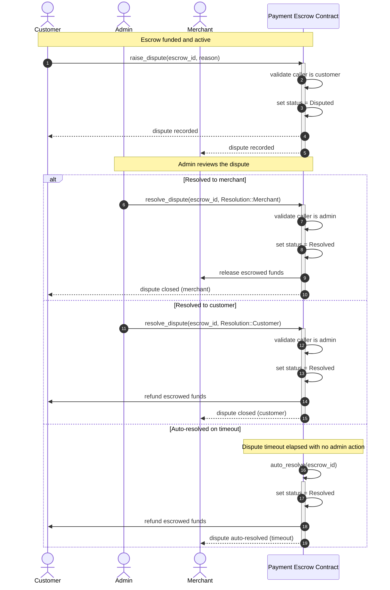

# Payment Escrow Contract

The Payment Escrow contract holds funds for a customer/merchant pair until delivery is confirmed, and provides a dispute resolution flow when the parties disagree.

## Storage Schema Versioning

Contract upgrades replace the WASM but keep the existing ledger storage. If the new
WASM expects a different storage layout, existing entries can be silently misread or
corrupted. To prevent this, the contract persists a `storage_version` field in its
instance storage and validates it on the first function call after an upgrade.

Strategy:

- **Version constant** — the contract source declares the schema version it was built
  against (e.g. `STORAGE_VERSION`). Every deployed WASM knows the layout it expects.
- **Persisted field** — `storage_version` is written to instance storage on
  `initialize` (and on any migration that changes the layout).
- **First-call validation** — every entry point loads `storage_version` from storage and
  compares it against the compiled-in constant. A mismatch aborts the call with a
  `StorageVersionMismatch` error instead of operating on incompatible state.
- **Migrations** — a layout change bumps the constant and ships a migration path that
  rewrites stored entries and updates `storage_version` in a single upgrade step. Never
  deploy a WASM whose constant differs from the stored value without a migration.
- **Missing field** — state written before versioning was introduced is treated as
  version `0`; the first upgrade that adds the field must migrate it explicitly.

This makes an incompatible upgrade fail loudly on the first call rather than corrupting
data silently.

## Dispute Resolution Flow

The sequence diagram below shows how a dispute moves through the contract: a customer raises it, an admin reviews it, and it is resolved either to the merchant, to the customer, or automatically on timeout.



### Outcomes

- **Resolved to merchant** — the admin sides with the merchant; escrowed funds are released to the merchant.
- **Resolved to customer** — the admin sides with the customer; escrowed funds are refunded to the customer.
- **Auto-resolved on timeout** — if no admin action is taken before the dispute timeout elapses, the dispute is resolved automatically in the customer's favor and funds are refunded.

## Upgrade Procedure

This section is the authoritative checklist for upgrading the deployed Payment Escrow contract. Do not skip steps; every box must be checked before proceeding to the next phase.

> **Golden rule:** never upgrade mainnet directly. Every upgrade is rehearsed on testnet first, and no mainnet upgrade proceeds without the multi-party sign-off in [Sign-off checklist](#sign-off-checklist).

### 1. Pre-upgrade checklist

- [ ] The new WASM is built from a tagged, reviewed commit and the build is reproducible (`make build` / CI artifact hash recorded).
- [ ] The changelog / PR description lists every storage schema change (new keys, renamed keys, changed value types, new `DataKey` variants).
- [ ] A migration plan exists for each schema change (see [State migration notes](#state-migration-notes)).
- [ ] The current on-chain contract version and WASM hash are recorded (see verification commands below).
- [ ] A full state snapshot / export of the current contract storage is taken and stored off-chain.
- [ ] Rollback path is confirmed: the previous WASM hash is available and re-deployable.
- [ ] The upgrade window is announced to integrators and the admin/timelock signers are available.
- [ ] Testnet rehearsal has passed (see [Testnet validation](#3-testnet-validation-required-before-mainnet)).

Record the baseline before touching anything:

```bash
# Current deployed WASM hash and contract version
stellar contract info --id <CONTRACT_ID> --network <testnet|mainnet>

# Export current storage for the snapshot
stellar contract read --id <CONTRACT_ID> --network <testnet|mainnet> --output json > escrow_state_pre_upgrade.json
```

### 2. State migration notes

Soroban contracts persist state in ledger storage, so a WASM upgrade does **not** automatically migrate existing entries. Handle schema changes explicitly:

- **New storage keys** — additive keys are safe; initialize them lazily on first read or via an explicit `migrate()` entrypoint guarded by admin auth.
- **Renamed / moved keys** — read the old key, write the new key, then remove the old key. Never delete before the new value is durably written.
- **Changed value types** — bump a stored `version` / `DataKey::Version` marker and branch reads on it so in-flight escrows written under the old layout still deserialize.
- **Data backfill** — if a field must be populated for existing escrows, iterate known escrow IDs in a bounded `migrate(batch)` call (respect the per-transaction instruction/entry limits; run multiple batches if needed).
- **Idempotency** — every migration step must be safe to re-run; guard with the version marker so a partially applied migration can be resumed.
- **Rollback** — the previous WASM must still be able to read state written by the new version, or a documented reverse migration must exist. If neither holds, the upgrade is **not** rollback-safe and requires explicit sign-off acknowledgement.

Document the concrete migration for this release in the PR before merging.

### 3. Testnet validation (required before mainnet)

- [ ] Deploy the new WASM to testnet: `stellar contract install --wasm <path> --network testnet`.
- [ ] Run the migration entrypoint (if any) against a copy of production-like state.
- [ ] Exercise the full dispute flow end-to-end: fund → `raise_dispute` → `resolve_dispute` (both `Merchant` and `Customer`) and the timeout `auto_resolve` path.
- [ ] Verify pre-existing escrows created under the old version still read and resolve correctly after the upgrade.
- [ ] Confirm the recorded post-upgrade WASM hash matches the intended artifact.
- [ ] Rehearse the rollback on testnet and confirm state remains readable.
- [ ] Attach testnet transaction hashes / evidence to the upgrade PR.

### 4. Mainnet upgrade

- [ ] Confirm all testnet boxes are checked and evidence is attached.
- [ ] Execute the upgrade through the admin timelock (see `contracts/admin_timelock/EMERGENCY_RUNBOOK.md` for the emergency path).
- [ ] Run the migration entrypoint (if any) in bounded batches and confirm completion.

### 5. Post-upgrade verification

- [ ] `stellar contract info` shows the expected new WASM hash and version.
- [ ] Spot-check a sample of pre-existing escrows: status, balances, and dispute fields are intact.
- [ ] Run a live smoke test: fund a small escrow, raise and resolve a dispute.
- [ ] Confirm no unexpected storage keys were orphaned (compare against the pre-upgrade snapshot).
- [ ] Monitor logs/metrics for errors during the observation window before declaring success.
- [ ] If any check fails, follow the rollback path and escalate per the sign-off checklist.

### Sign-off checklist

A mainnet upgrade requires sign-off from **all** of the following roles. Record names, dates, and links to evidence in the upgrade PR.

- [ ] **Contract lead** — reviewed the code, schema changes, and migration plan; confirms testnet rehearsal passed.
- [ ] **Reviewer** (independent) — reviewed the diff and migration/rollback plan; confirms no unaddressed schema risks.
- [ ] **Ops / release manager** — confirms snapshot taken, rollback WASM available, upgrade window announced, and monitoring in place.
- [ ] **Admin / timelock signer** — confirms authorization to execute the upgrade and is available during the window.

No mainnet upgrade is executed until every box above is checked by the named role.
