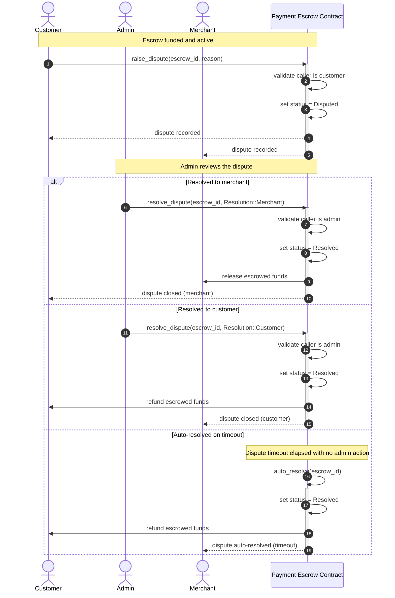

# Payment Escrow Contract

The Payment Escrow contract holds funds for a customer/merchant pair until delivery is confirmed, and provides a dispute resolution flow when the parties disagree.

## Dispute Resolution Flow

The sequence diagram below shows how a dispute moves through the contract: a customer raises it, an admin reviews it, and it is resolved either to the merchant, to the customer, or automatically on timeout.

### Outcomes

- **Resolved to merchant** — the admin sides with the merchant; escrowed funds are released to the merchant.
- **Resolved to customer** — the admin sides with the customer; escrowed funds are refunded to the customer.
- **Auto-resolved on timeout** — if no admin action is taken before the dispute timeout elapses, the dispute is resolved automatically in the customer's favor and funds are refunded.
