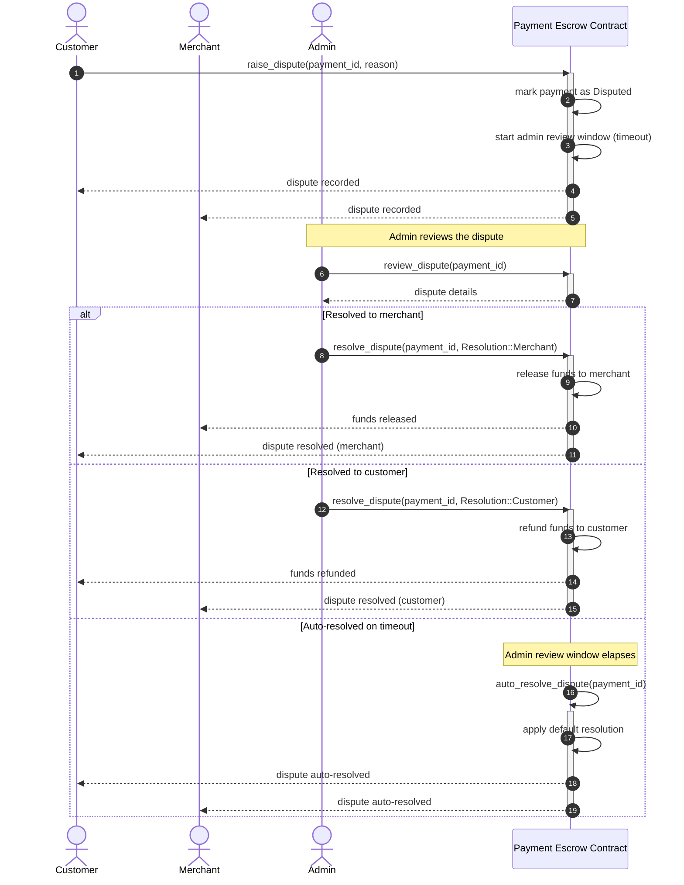

# Payment Escrow Contract

The Payment Escrow contract holds funds in escrow between a payer and a merchant until the payment is released, refunded, or a dispute is resolved.

## Dispute Resolution Flow

The following sequence diagram illustrates how a dispute is raised and resolved, including resolution to the merchant, resolution to the customer, and automatic resolution when the admin review window times out.

