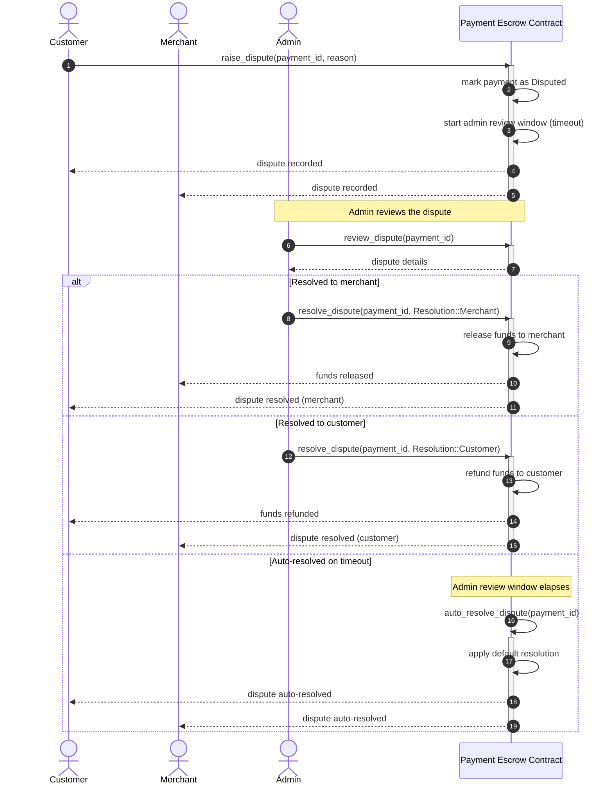

# Payment Escrow Contract

The Payment Escrow contract holds funds in escrow between a payer and a merchant until the payment is released, refunded, or a dispute is resolved.

## Dispute Resolution Flow

The following sequence diagram illustrates how a dispute is raised and resolved, including resolution to the merchant, resolution to the customer, and automatic resolution when the admin review window times out.

## Deadline Passed Event

When a dispute's resolution deadline (`dispute_resolution_deadline` ledger) has been reached or passed, anyone may call the permissionless `auto_resolve_dispute(payment_id)` entrypoint. This entrypoint panics if the deadline has not yet passed, so it only succeeds for genuinely expired disputes.

On success it emits a `DeadlinePassed` event so the backend Soroban event indexer can detect expired disputes and trigger auto-resolution without polling every escrow. The event carries enough context to identify the expired dispute:

| Field | Description |
| --- | --- |
| `escrow_id` / `payment_id` | Identifier of the escrow whose dispute expired |
| `dispute_id` | Identifier of the expired dispute |
| `deadline` | The dispute resolution deadline ledger that was passed |

Indexers should subscribe to the `DeadlinePassed` topic and action the referenced dispute accordingly.
